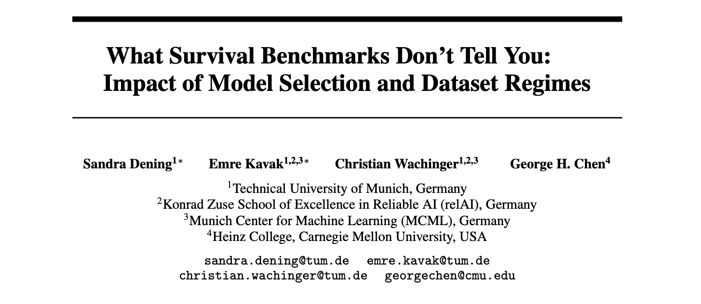

<p align="center">
  <a href="https://www.tum.de/en/"></a>
  &nbsp;&nbsp;&nbsp;&nbsp;
  <a href="https://www.cmu.edu/"></a>
  &nbsp;&nbsp;&nbsp;&nbsp;
  <a href="https://neurips.cc/"></a>
</p>

**Accepted at NeurIPS 2026 · Evaluations & Datasets Track**


[Findings](#paper--findings) · [Structure](#repository-structure) · [Quick start](#run-an-example) · [Settings](#change-training-settings) · [References](REFERENCES.md)

Research code for comparing classical, tree-based, and deep learning (DL) survival models across model-selection criteria and dataset regimes.

## Paper & findings

The benchmark compares **10 methods across 49 datasets**, while treating the model-selection criterion as an independent experimental variable. C-index (ranking/discriminative performance), IBS (probalistic accuracy) and MAE-PO (time accurancy) are varied as model-selection criteria.


 **Different metrics reveal different drivers.** Dataset baseline difficulty explains 67.4% of C-index variance in the Bayesian analysis. Model choice, selection strategy, and dataset features jointly explain 52.6% of IBS variance and 70.9% of log X-CAL variance (Figure 2 in Paper).
 **Select for probabilistic accuracy.** Switching from C-index to IBS selection improves IBS and calibration for several flexible models, with little change in discrimination (Table 1 in Paper).
 **Target event-time accuracy directly.** MAE-PO selection raises the reported frequency of outperforming Kaplan–Meier on MAE-PO from about **50% to 72.3%** (Table 11 in Paper).


 **Scale and dimensionality change the ranking.** Several DL and tree-based methods benefit from larger samples, while high-dimensional feature spaces challenge deep learning (§4.3 B.1 in Paper).
 **Heavy censoring can mask miscalibration.** Absolute X-CAL values and D-calibration tests can look reassuring under heavy censoring. A non-rejection does not establish that a model is well calibrated (§4.3 B.2 in Paper). This is crucial for absolute ranking.

> **Recommendation**: Match model selection to the prediction task, and report performance by dataset characteristics.


## Models & evaluation

CoxPH · CoxNet (elastic net) · Random Survival Forest · Gradient Boosting · XGBoost · DeepSurv · CoxTime · DeepHit · CoxKAN · SurvTRACE

Hyperparameters are selected using **time-dependent C-index**, **integrated Brier score (IBS)**, or **pseudo-observation mean absolute error (MAE-PO)**. CoxPH is included as a parameter-free baseline.

Evaluation covers discrimination, prediction error, and calibration using C-index, IBS, MAE-PO, and X-calibration. Training scripts provide cross-validation, saved results, and optional diagnostic plots.

## Repository structure

```text
repo_name/
├── Data_Preprocessing/
│   ├── configs/                  # Dataset sources and outcome columns
│   ├── run_preprocess.py         # Preprocess a SurvSet dataset
│   ├── run_preprocess_*.py       # Dedicated loaders for external datasets
│   ├── src/                      # Shared preprocessing utilities
│   └── data/processed/           # Generated datasets (created when run)
├── Model_Training/
│   ├── method_configs/           # Hyperparameter grids and preprocessing
│   ├── modeling/                 # Training Scripts
│   │   ├── coxPH_modeling.py      # Fixed CoxPH baseline
│   │   ├── cindex_model_selection/
│   │   ├── ibs_model_selection/
│   │   ├── mae_model_selection/
│   │   └── experiment_results/   # Generated results, logs, and plots
│   ├── src/                      # Modeling, evaluation, and plotting helpers
│   └── third_party/survtrace/    # Locally adapted SurvTRACE implementation
├── Data_Analysis/                # Dataset summaries and analysis notebook
├── conda_env.txt                 # Main environment package listing
├── conda_env_coxtime.txt         # CoxTime environment package listing
└── ReadMe.md
```

## Run an example

**Environment.** Use the package versions recorded in `conda_env.txt` (Python 3.10.19); `conda_env_coxtime.txt` records the CoxTime environment. These are package listings, not installable environment specifications. The commands below assume the dependencies are installed.

### 1. Preprocess a dataset

From the repository root, prepare the SurvSet `veteran` dataset for Random Survival Forest (RSF):

```bash
cd Data_Preprocessing
python run_preprocess.py veteran rsf
cd ..
```

The arguments are the dataset name and the method configuration name. This writes `Data_Preprocessing/data/processed/veteran/veteran_processed.csv`.

> **Note**: Re-run preprocessing when changing the method or its preprocessing settings. 

SUPPORT2, METABRIC, ADNI, MIMIC-IV, KKBox, and borrow/repay use dedicated `run_preprocess_*.py` scripts. Prepare their required source data first.

### 2. Train and evaluate

From the repository root, run RSF with IBS-based model selection:

```bash
python Model_Training/modeling/ibs_model_selection/rsf_modeling_IBS.py \
  --datasets veteran \
  --n_folds 5 \
  --save_plots
```

Results, logs, and optional plots are written under `Model_Training/modeling/experiment_results/`.

### 3. Change the selection criterion

Use the corresponding script with the same RSF-preprocessed data:

```bash
# Select hyperparameters using C-index
python Model_Training/modeling/cindex_model_selection/rsf_modeling_cindex.py --datasets veteran

# Select hyperparameters using MAE-PO
python Model_Training/modeling/mae_model_selection/rsf_modeling_MAE_MLA.py --datasets veteran
```

## Change training settings

**Run settings** are command-line arguments. For example, use three folds and a shorter search budget:

```bash
python Model_Training/modeling/ibs_model_selection/rsf_modeling_IBS.py \
  --datasets veteran \
  --n_folds 3 \
  --fold_time_budget_h 1
```

`--datasets` accepts multiple names, each preprocessed for the selected method. `--save_plots` enables diagnostic plots. The time budget is checked between hyperparameter fits; it is not a hard wall-clock limit. The RSF scripts set `seed = 42` in the script rather than exposing a `--seed` option.

**Hyperparameters** live in `Model_Training/method_configs/`. For a smaller trial run for example, replace only the `hyperparameter_grid` block in `rsf.yaml`:

```yaml
hyperparameter_grid:
  n_estimators: [50]
  max_depth: [3, 6]
  min_samples_split: [0.1]
  min_samples_leaf: [0.05]
```

Each list defines candidate values; this example tests two combinations. Keep the remaining configuration fields. This reduced grid is for exploration, not reproduction of the paper's full search.

For DL models, the corresponding YAML also controls training settings. For example, `deepsurv.yaml` exposes `learning_rate`, `batch_size`, `epochs`, `hidden`, and `dropout`.

**Preprocessing settings** live in the same method YAML under `preprocessing` (for example, `scaling`, `drop_nzv`, and `corr_threshold`). Dataset sources and outcome-column names live in `Data_Preprocessing/configs/`. Re-run preprocessing after changing these settings.

## References & citation

Library credits, dataset sources, and the original repository’s BibTeX entries are collected in [REFERENCES.md](REFERENCES.md). The code includes a locally adapted [SurvTRACE](https://github.com/RyanWangZf/SurvTRACE) implementation.

**Sandra Dening\*, Emre Kavak\*, Christian Wachinger, and George H. Chen.** *What Survival Benchmarks Don’t Tell You: Impact of Model Selection and Dataset Regimes.* NeurIPS 2026, Evaluations & Datasets Track (* equal contribution).

todo: paste paper link arxiv here
